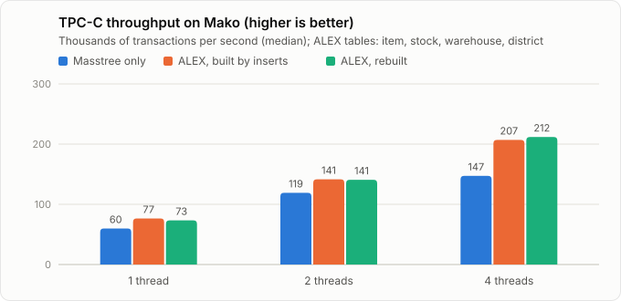
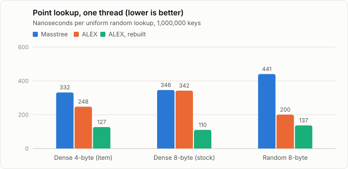
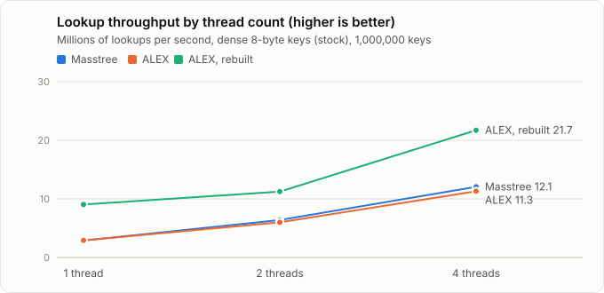
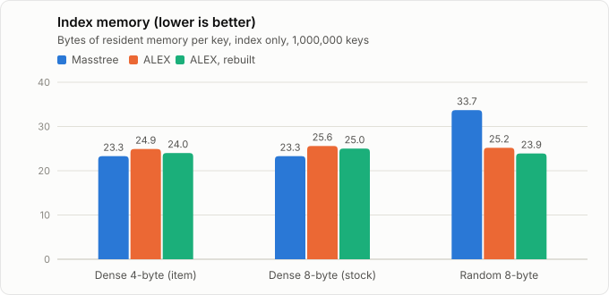

# learned-index-mako

[](https://github.com/varunbhandarii/learned-index-mako/actions/workflows/ci.yml)

The [ALEX](https://github.com/microsoft/ALEX) learned index inside
[Mako](https://github.com/makodb/mako) (OSDI '25), a distributed transactional key-value
store, with serializability preserved and a fair comparison against Mako's default index,
Masstree.

A learned index replaces tree traversal with a model that predicts where a key is stored.
In standalone benchmarks that can save memory and time. This project asks what happens
inside a real OLTP engine, with optimistic concurrency control, multi-version records and
range scans.

## Results

All numbers were measured on a 4-vCPU, 8 GB Docker Desktop VM on a Windows 11 laptop, with
GCC 12. Raw logs and summaries are in [`bench/results/`](bench/results/).

### TPC-C on Mako

<picture>
  <source media="(prefers-color-scheme: dark)" srcset="docs/img/tpcc-throughput-dark.svg">
  
</picture>

One shard without replication, one warehouse per worker thread, Mako's 30-second
measurement window. **Masstree** keeps every table on Masstree. The ALEX configurations
move `item`, `stock`, `warehouse` and `district` to ALEX, either as Mako's loaders build
it (**built by inserts**) or repacked with ALEX's bulk loader once loading finishes
(**rebuilt**, the default). All other tables stay on Masstree. Medians of 3 interleaved
runs per configuration, with ranges in parentheses.

| Throughput (txn/s) | Masstree | ALEX, built by inserts | ALEX, rebuilt |
| :--- | ---: | ---: | ---: |
| 1 thread | 59,917 (57,028–62,631) | 76,540 (65,034–80,834) **+28%** | 73,376 (72,922–80,354) **+22%** |
| 2 threads | 119,088 (106,216–126,895) | 141,462 (106,436–144,840) +19% | 140,830 (98,145–145,962) +18% |
| 4 threads | 147,336 (142,968–147,434) | 206,948 (165,533–243,043) **+40%** | 211,893 (154,693–232,498) **+44%** |

| At 4 threads | Masstree | ALEX, built by inserts | ALEX, rebuilt |
| :--- | ---: | ---: | ---: |
| StockLevel latency | 0.130 ms | 0.073 ms (−44%) | 0.073 ms (−44%) |
| NewOrder latency | 0.030 ms | 0.021 ms (−31%) | 0.020 ms (−33%) |
| Abort rate | 23 /s | 25 /s | 26 /s |
| Memory (RSS) after loading | 518 MiB | 549 MiB | 525 MiB |
| Loading time | 4.2 s | 5.0 s | 5.0 s, plus 32 ms to rebuild |

What this shows:

- **ALEX tables make TPC-C faster.** StockLevel looks up about 200 `stock` rows per
  transaction and NewOrder about 20 `item` and `stock` rows. TPC-C's keys are dense
  integers, so ALEX's linear models predict positions almost exactly, and a lookup touches
  fewer cache lines than a descent through Masstree. At 1 and 4 threads every ALEX run
  beat every Masstree run; at 2 threads the ranges overlap.
- **The lock mattered more than the rebuild.** With `std::shared_mutex`, the first round
  of measurements gained 17% at 4 threads
  ([`bench/results/tpcc-shared-mutex-t4`](bench/results/tpcc-shared-mutex-t4/)); with the
  read-mostly lock it gains 40–44%. Those were separate sessions on the same machine, so
  compare the ratios, not the absolute numbers. Rebuilding barely changes TPC-C, even
  though it makes lookups 2–3× faster in isolation (below): TPC-C's skewed accesses keep
  hot rows in cache, and lookups are only part of each transaction.
- **No memory saving.** The rows, not the index, take the memory. ALEX's index for these
  tables is about 23 bytes per key, roughly 2% of the process; RSS stays within ±6%.
  Rebuilding returns most of the extra memory that insert-built ALEX uses.
- **No extra aborts.** Phantom protection for ALEX tables costs nothing here, because those
  tables get no inserts after loading.
- **Loading is slower.** Inserting into ALEX costs more than into Masstree, and every
  insert pays the read-mostly lock's writer cost.

This is a small machine with short runs, so treat the size of the gains as indicative.
Reproduce with `bench/run_tpcc.sh` (see [Build and run](#build-and-run)).

### The index on its own

[`bench/index_bench.cc`](bench/index_bench.cc) compares the indexes without the rest of
the database: one million keys, uniform random point lookups, values that are pointers so
that memory is the index alone, and Masstree configured exactly as Mako's tables are.
**ALEX** is built by inserts, as Mako builds it while loading; **ALEX, rebuilt** is then
repacked with ALEX's bulk loader (`AlexIndex::rebuild()`). Medians of 3 runs, one process
per configuration
([`bench/results/index-2026-10-27`](bench/results/index-2026-10-27/)).

<picture>
  <source media="(prefers-color-scheme: dark)" srcset="docs/img/lookup-latency-dark.svg">
  
</picture>

<picture>
  <source media="(prefers-color-scheme: dark)" srcset="docs/img/lookup-scaling-dark.svg">
  
</picture>

<picture>
  <source media="(prefers-color-scheme: dark)" srcset="docs/img/index-memory-dark.svg">
  
</picture>

| Key set | Lookup, 1 thread: Masstree / ALEX / rebuilt | Lookups/s, 4 threads: Masstree / ALEX / rebuilt | Bytes per key: Masstree / ALEX / rebuilt |
| :--- | :--- | :--- | :--- |
| Dense 4-byte ids (item) | 332 / 248 / 127 ns | 12.2 / 18.2 / 23.4 M | 23.3 / 24.9 / 24.0 |
| Dense 8-byte pairs (stock) | 346 / 342 / 110 ns | 12.1 / 11.3 / 21.7 M | 23.3 / 25.6 / 25.0 |
| Random 8-byte keys | 441 / 200 / 137 ns | 9.6 / 20.6 / 20.4 M | 33.7 / 25.2 / 23.9 |

What this shows:

- **A packed learned index is much faster per lookup.** Rebuilt, ALEX answers a lookup in
  110–137 ns against Masstree's 332–441 ns, 2.6–3.2× faster on one thread. Built by
  inserts, its gain depends on the keys: 1.3× on item-like ids, none on stock-like pairs.
- **It now scales past Masstree.** On 4 threads, rebuilt ALEX serves 1.8–2.1× Masstree's
  lookups per second. With `std::shared_mutex` it managed only 0.7–0.9× Masstree, because
  every reader updated the same lock word
  ([`bench/results/index-2026-10-27-shared-mutex`](bench/results/index-2026-10-27-shared-mutex/)).
- **Memory is a tie on TPC-C keys.** On dense keys both indexes use 23–26 bytes per key.
  On random keys, where Masstree's nodes fill less evenly, ALEX uses 25–29% less.

### With replication

Mako's own 1-shard replication test (a leader, two followers and a learner, 2 threads
each) passes with ALEX tables on the leader. The followers replayed 3,207 log batches
(2,413 with Masstree only), and the leader persisted 42,826 transactions/s against
31,291 (one run each, so indicative; logs in
[`bench/results/replication-2026-10-27/`](bench/results/replication-2026-10-27/)). The
followers keep every table on Masstree, though: they address tables by numeric id while
replaying and never learn the names that select ALEX. Each process choosing its own index
is safe, but replay into ALEX is not exercised yet.

## How it works

### Keys keep their order

ALEX only indexes numbers. Mako keys are byte strings whose integer fields are encoded
big-endian, so for keys of up to 8 bytes the big-endian integer value of the bytes is an
exact, order-preserving encoding:

```
TPC-C stock key (warehouse 3, item 1042)  ->  00 00 00 03 00 00 04 12  ->  0x0000000300000412
```

ALEX's numeric order is then the table's key order: range scans walk the index directly,
and two different keys can never map to the same number.
[`AlexIndex`](src/alex_index.h) accepts bounds of any length and converts them to exact
numeric ranges, so it matches Masstree's scan semantics for every bound.

### Only where it fits

A table uses ALEX when `MAKO_INDEX=alex` and its name is in `MAKO_ALEX_TABLES` (default
`item,stock,warehouse,district`, the TPC-C tables with keys of 8 bytes or less). Every
other table stays on Masstree. A table's index is chosen once, when Mako names it, before
any data is loaded. When loading finishes, every ALEX table is repacked with ALEX's bulk
loader, which takes milliseconds; `MAKO_ALEX_REBUILD=0` skips that step.

### Transactions stay serializable

Mako runs optimistic concurrency control (STO). Values in ALEX tables are the same
versioned records Masstree tables use, so reads, writes, locking, commit and abort are
unchanged. Two things needed real work ([`patches/mako.patch`](patches/mako.patch)):

- **Phantoms.** On Masstree, a lookup that misses records the version of the tree node it
  landed in, and commit fails if that node changed. An ALEX index has a structural version
  instead, bumped on every insert and erase. Misses and scans record it, and commit fails
  if it moved. That is coarser than per-node validation, but the tables that suit ALEX
  have no inserts once loaded, so it costs no aborts there.
- **Inserts.** `insert_if_absent` checks and inserts under one lock, so two transactions
  can't both insert the same key, and a transaction's own insert doesn't invalidate a
  version it observed just before. Removed records are freed through Mako's RCU, as on
  Masstree.

### Concurrency

ALEX is single-threaded, so each table has a reader-writer lock. Two details make that
work:

- **Readers don't share a cache line.** With `std::shared_mutex`, every lookup updates the
  same lock word, so readers on different cores slow each other down. In
  [`ReadMostlyLock`](src/read_mostly_lock.h), each reader thread counts itself in its own
  64-byte slot and then checks a writer flag. A writer raises the flag and waits for every
  slot to drain. With sequentially consistent ordering, one side always sees the other.
  Writers pay more, which suits tables that are read on every transaction and almost
  never change after loading. (The old lock also let readers starve writers: the
  concurrency test took 26 s with it and under 1 s now.)
- **Lookups write nothing.** ALEX's lookups update per-node statistics, so even
  shared-lock reads would race. [`patches/alex.patch`](patches/alex.patch) makes those
  updates optional, and the adapter turns them off.

### Bugs found in ALEX

The randomized differential test (below), run under sanitizers, found four problems in
ALEX itself, fixed in [`patches/alex.patch`](patches/alex.patch). The memory-safety and
undefined-behaviour fixes are proposed upstream, with regression tests, in
[microsoft/ALEX#39](https://github.com/microsoft/ALEX/pull/39).

1. **Out-of-bounds read.** `find_lower()`/`find_upper()` can pass `pos == data_capacity_`
   to `get_next_filled_position()`, which then reads one bitmap word past the array when
   the capacity is a multiple of 64 (first seen under ThreadSanitizer; a direct node-level
   test reproduces it as an AddressSanitizer heap-buffer-overflow).
2. **Data race.** Lookups write statistics, as described above.
3. **Undefined behaviour.** `delete_node()` downcast nodes after destroying them (UBSan).
4. **Signed overflow.** `extract_rightmost_one()` negated a bitmap word as `int64_t`, which
   overflows when only the top bit is set (UBSan).

ALEX's node-splitting code also casts data nodes to `AlexDataNode<T, P>` with default
template arguments, so the adapter uses `Alex<uint64_t, void*>` and enforces unique keys
itself.

## Testing

[`tests/alex_index_test.cc`](tests/alex_index_test.cc):

- unit tests for lookups, inserts, versions, rejected keys, and scans with bounds shorter
  than, equal to and longer than the key length;
- a randomized differential test of 20,000 operations per key length (1 to 8 bytes)
  against `std::map`, using key bytes such as `0x00`, `0x7f`, `0x80` and `0xff` to hit
  padding and boundary cases;
- a concurrency test with readers checking every value they see while a writer inserts,
  erases and rebuilds.

[`tests/read_mostly_lock_test.cc`](tests/read_mostly_lock_test.cc) checks that readers
share the lock, that writers and readers exclude each other, and that readers never see
a half-finished write under load.

CI runs them as a plain build, with AddressSanitizer + UndefinedBehaviorSanitizer, and
with ThreadSanitizer, and checks that `patches/mako.patch` applies to the pinned Mako.

## Repository layout

```
src/alex_index.{h,cc}   order-preserving ALEX adapter (compiled as C++17, see below)
src/read_mostly_lock.h  reader-writer lock whose readers don't share a cache line
patches/alex.patch      ALEX fixes, applied to a copy at build time
patches/mako.patch      Mako integration: MassTrans.hh and the CMake hook
tests/                  unit, differential and concurrency tests
bench/                  TPC-C and index benchmarks, results, chart script
docs/img/               charts used in this README (light and dark)
docker/Dockerfile       build environment (Mako's own dependency list)
third_party/            ALEX and Mako as pinned submodules
```

ALEX uses `std::allocator::rebind`, which C++20 removed, so `alex_index.cc` is compiled as
C++17 while Mako is C++23. Only plain types cross [`alex_index.h`](src/alex_index.h).

## Build and run

Unit tests (needs CMake, a C++17 compiler and `patch`):

```bash
git submodule update --init third_party/ALEX
cmake -S . -B build -DLIM_SANITIZE=address   # or thread, or leave it out
cmake --build build -j && ctest --test-dir build --output-on-failure
```

Mako with ALEX, and the benchmarks (Linux; the Docker image has every dependency):

```bash
docker build -t learned-index-mako docker/
docker run --rm -it -v "$PWD:/lim" learned-index-mako
scripts/build_mako.sh          # fetches pinned Mako, applies the patch, builds the binaries
bench/run_tpcc.sh 2 3          # TPC-C: 2 threads, 3 runs of each configuration
bench/run_index_bench.sh       # index microbenchmark: 1M keys, 3 runs
python3 bench/plot.py docs/img bench/results/index-<date> bench/results/tpcc-<date>-t*
```

## Limitations

- Keys longer than 8 bytes (TPC-C `customer`, `order_line`, ...) stay on Masstree.
  Order-preserving compression of wider keys would extend coverage.
- Phantom protection is per index, not per node: any insert into an ALEX table aborts
  concurrent transactions that missed or scanned in it. Fine for read-mostly tables,
  costly for insert-heavy ones.
- Writers to an ALEX table exclude all its readers, and every insert pays the read-mostly
  lock's writer cost. That suits read-mostly tables; for write-heavy ones, a concurrent
  learned index such as ALEX+ from the [GRE benchmark](https://github.com/gre4index/GRE)
  would fit better.
- The 4-vCPU test machine can't show how far the read-mostly lock scales.
- Replicas keep their tables on Masstree, because Mako's followers never learn table
  names. Selecting ALEX by table id, or sending names to followers, would fix that.
- Mako is pinned at its November 2025 commit (`0b62cf1`).

## Background

This is a rebuild of a CSE 532 (Database Systems) course project built with Manush Patel
and Dharma Bagadia. That version mapped keys to integers with
`std::stoull` and hashing, which made distinct keys collide and forced every range scan to
sort the whole table, and it skipped phantom protection for ALEX tables. In its own logs,
ALEX runs committed 17 transactions per second against Masstree's 21,141, so its reported
3.4× memory saving came from runs that did several hundred times less work. This rebuild
puts only suitable tables on ALEX, keeps keys in order, and is faster than Masstree on
the same benchmark.

## Credits

- [Mako](https://github.com/makodb/mako): MIT License, © Shuai Mu and contributors.
- [ALEX](https://github.com/microsoft/ALEX): MIT License, © Microsoft Corporation.

## License

MIT. See [LICENSE](LICENSE) and [THIRD_PARTY_NOTICES.md](THIRD_PARTY_NOTICES.md).
